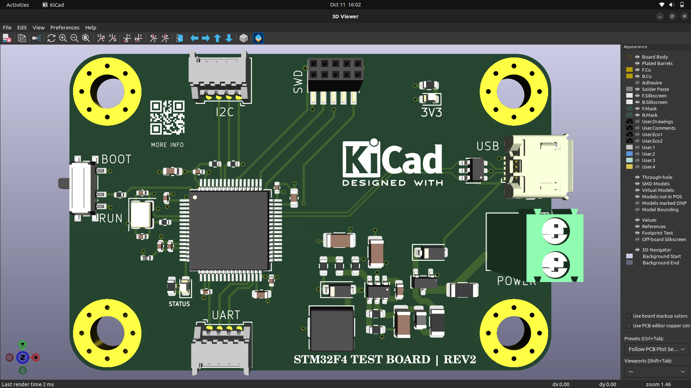
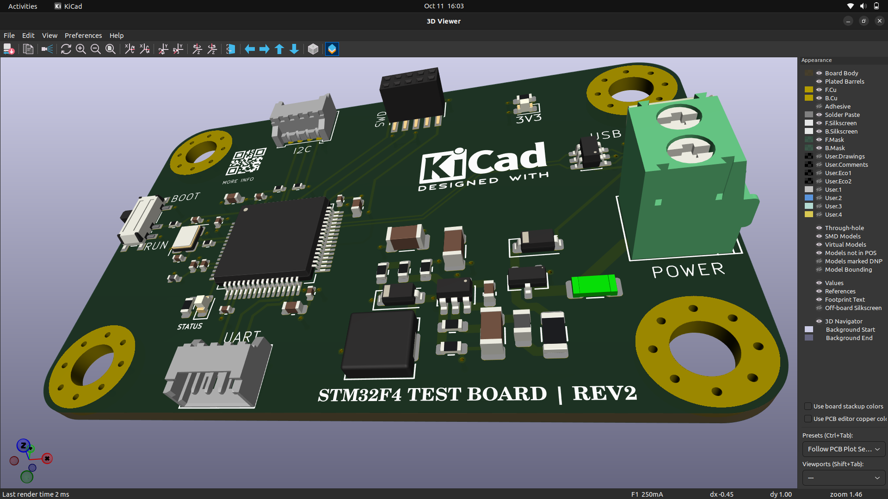
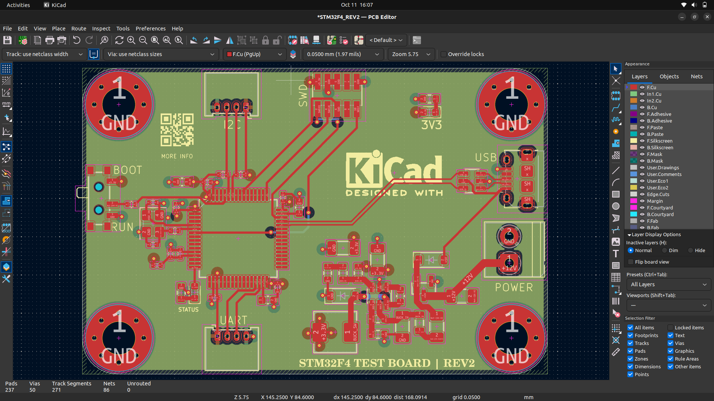
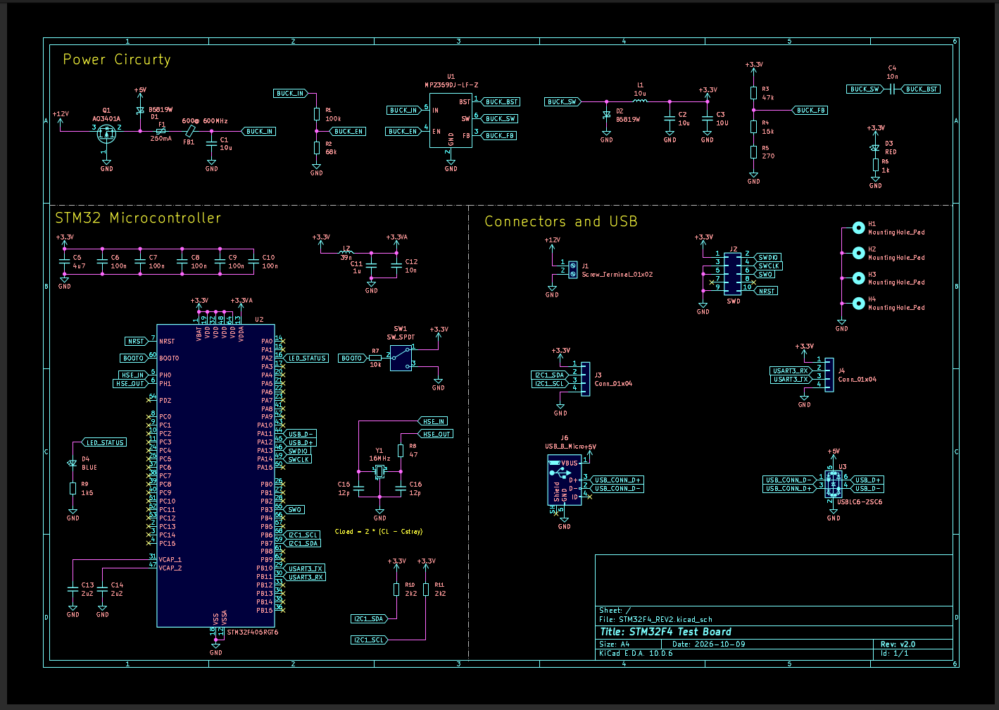

# STM32F4 Test Board (REV2)

A compact STM32F405-based development board designed in **KiCad 10**. It has a 12 V screw-terminal power input, an on-board buck converter, USB micro-B, and standard debug and communication headers (SWD, I2C, UART).



## Features

- **MCU:** STM32F405RGT6 (ARM Cortex-M4, LQFP-64), 16 MHz crystal
- **Power input:** 12 V via 2-pin screw terminal, protected by a 250 mA fuse
- **Buck converter:** MP2359DJ-LF-Z (adjustable, feedback resistor divider)
- **USB:** micro-B connector with USBLC6-2SC6 ESD protection
- **Programming and debug:** 10-pin SWD header (SWCLK, SWDIO, SWO, NRST)
- **Communication:** I2C1 header (with 2.2 kOhm pull-ups) and USART3 header
- **User interface:** BOOT0 slide switch (BOOT / RUN), red power LED, blue status LED
- **Mounting:** four M3-style mounting holes with GND pads
- **Board:** 4-layer, rounded corners

## Board Preview

| 3D view (angled) | PCB layout |
|---|---|
|  |  |

## Schematic

The schematic has three sections:

1. **Connectors and USB**: power terminal, USB micro-B, SWD, I2C and UART headers
2. **Power circuitry**: MP2359 buck converter, inductor, diodes, ferrite bead for the analog supply
3. **STM32 microcontroller**: STM32F405RGT6, crystal, decoupling, BOOT0 and reset circuit

The PDF is in [`docs/STM32F4_REV2.pdf`](STM32F4_REV2/docs/STM32F4_REV2.pdf).



## Main Components

| Ref | Part | Purpose |
|---|---|---|
| U2 | STM32F405RGT6 | Main microcontroller |
| U1 | MP2359DJ-LF-Z | Buck converter |
| U3 | USBLC6-2SC6 | USB ESD protection |
| Q1 | AO3401A | P-channel MOSFET (power path) |
| D1, D2 | B5819W | Schottky diodes |
| D3 / D4 | Red LED / Blue LED | Power indicator / Status LED |
| Y1 | 16 MHz crystal | HSE clock |
| F1 | 250 mA fuse | Input protection |
| FB1 | 600 ohm @ 600 MHz ferrite bead | Analog supply filtering |
| L1, L2 | Inductors | Buck converter and filtering |
| SW1 | SPDT slide switch | BOOT0 select (BOOT / RUN) |
| J1 | Screw terminal 1x02 | 12 V power input |
| J2 | 2x5 header | SWD |
| J3 | 1x04 connector | I2C1 (SCL, SDA) |
| J4 | 1x04 connector | USART3 (TX, RX) |
| J6 | USB micro-B | USB data |
| H1-H4 | Mounting holes | Board mounting |

Full values are in the schematic and in the generated BOM.

## Repository Structure

```
.
├── STM32F4_REV2.kicad_pro      # KiCad project
├── STM32F4_REV2.kicad_sch      # Schematic
├── STM32F4_REV2.kicad_pcb      # PCB layout
STM32F4_REV2
├── libraries/                  # Custom symbols, footprints and 3D models
├── fabrication/                # Gerber, drill, BOM and position files
├── docs/                       # Schematic PDF, datasheets
├── images/  
└── README.md
```

## How to Open

1. Install [KiCad 10](https://www.kicad.org/download/).
2. Clone or download this repository.
3. Open `STM32F4_REV2.kicad_pro` in KiCad.
4. If KiCad shows missing symbol, footprint or 3D model errors, check **Preferences, Manage Symbol/Footprint Libraries** and **Configure Paths**, and point them to the `libraries/` folder.

## Fabrication

Production files are in `fabrication/`. To regenerate them in KiCad:

1. **PCB Editor, File, Fabrication Outputs, Gerbers (.gbr)**, then **Generate Drill Files**.
2. **File, Fabrication Outputs, Component Placement (.pos)** for assembly.
3. **Schematic Editor, Tools, Generate BOM** for the bill of materials.
4. Zip the Gerber and drill files and upload them to your PCB manufacturer.

Before ordering, run **ERC** in the schematic editor and **DRC** in the PCB editor, and make sure both show no errors.

## Status

- [x] Schematic complete
- [x] PCB layout and routing complete
- [x] 3D models assigned
- [ ] Board fabricated
- [ ] Board tested

## Credits

- Designed in [KiCad](https://www.kicad.org/) 10.
- Reference design and tutorial: Phil's Lab (YouTube), "KiCad STM32 + USB + Buck Converter PCB Design" (#11).
- MP2359 symbol/footprint and Molex connector 3D model from SnapMagic.


## Author

Pravin Kumar Sharma, ECE student.
